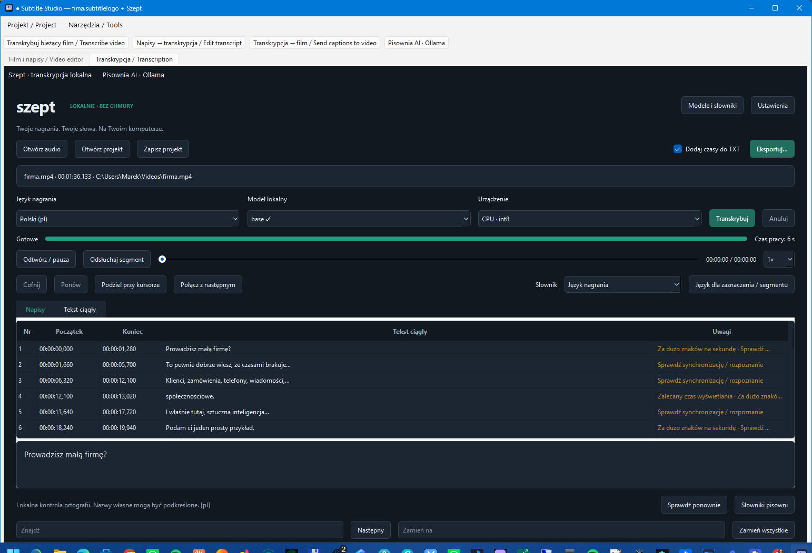
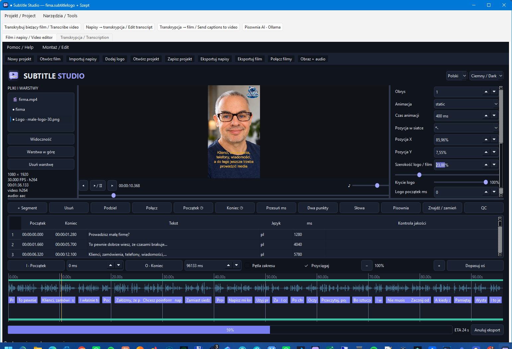
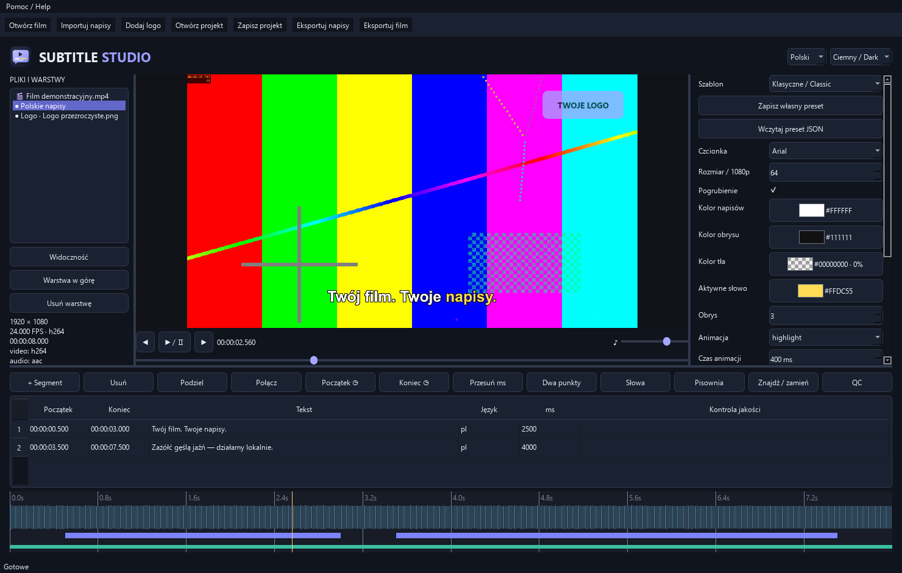

# Subtitle Studio — lokalny edytor napisów i logo

## Wersja 0.6.1

Poprawiono start transkrypcji z filmu, wybór plików wideo, zakres napisów wysyłanych do Ollamy oraz synchronizację i układ animacji. [Instrukcja poprawek 0.6.1](docs/POPRAWKI_0.6.1.md).

Poprawki ochrony danych i synchronizacji z audytu, wspólny projekt obu kart, aktualizacja powiązanej ścieżki, naprawa czasów, edycja słów na fali audio, kolejka eksportów i pokaz zdjęć z muzyką. Dodano **lokalną korektę AI przez Ollamę** z podglądem i wyborem propozycji. [Nowości i obsługa](docs/NOWOSCI_0.6.md) · [Ollama](docs/OLLAMA.md).

## Zrzuty ekranu

Lokalna transkrypcja filmu i edycja rozpoznanych napisów w module Szept.



Edycja filmu z napisami i logo, osią czasu, falą audio oraz eksportem.



## Integracja Szept — wersja 0.5.0

Jedno okno zawiera karty **Film i napisy** oraz **Transkrypcja**. Lokalny Whisper, edytor tekstu, menedżer modeli i słowników pochodzą z Szept. Przyciski nad kartami przekazują film do transkrypcji oraz napisy w obie strony, zachowując poprawne czasy słów. [Instrukcja integracji](docs/INTEGRACJA_SZEPT.md). Połączone wydanie: GPL-3.0-or-later; pierwotna informacja MIT pozostaje w docs/SUBTITLE_STUDIO_MIT.txt.

Wersja 0.4.0 dodaje kreator „Obraz + audio”. Ze zdjęcia lub klipu i osobnego dźwięku utworzysz MP4 w proporcjach 16:9, 9:16, 1:1, 4:5, 4:3 albo we własnym rozmiarze. Podgląd pokazuje dopasowanie całego obrazu lub przycięcie do kadru.

Wersja 0.3.0 dodaje łączenie filmów, zoom i przyciąganie na osi czasu, przeciąganie granic napisów, duplikowanie, domykanie czasu tekstu oraz zakres odtwarzania i eksportu. [Obsługa nowych funkcji](docs/CONCAT.md)

Działająca aplikacja Windows w Pythonie i PySide6, z eksportem FFmpeg. Wdrożono MVP oraz część funkcji etapów 2–3 ze specyfikacji. To nie jest deklaracja realizacji całej specyfikacji; szczegółowy zakres znajduje się w [docs/STATUS.md](docs/STATUS.md).

## Uruchomienie

Publiczne [wydanie 0.6.1](https://github.com/zetmar-collab/subtitle-studio/releases/tag/v0.6.1) zawiera instalatory Windows x64, wersję przenośną, źródła oraz sumy SHA-256.

- [Instalator standardowy 0.6.1](https://github.com/zetmar-collab/subtitle-studio/releases/download/v0.6.1/SubtitleStudio-Setup-0.6.1-x64.exe) zawiera Python i biblioteki aplikacji; nie wymaga oddzielnej instalacji Pythona.
- [Wersja przenośna ZIP](https://github.com/zetmar-collab/subtitle-studio/releases/download/v0.6.1/SubtitleStudio-Windows-x64.zip) — rozpakuj cały katalog i uruchom `SubtitleStudio.exe`.
- [Instalator Online 0.6.1](https://github.com/zetmar-collab/subtitle-studio/releases/download/v0.6.1/SubtitleStudio-Setup-0.6.1-Online-x64.exe) wymaga Pythona 3.12 i internetu przy pierwszym uruchomieniu, aby pobrać zależności z PyPI.

Do pracy z filmem zainstaluj FFmpeg i udostępnij ffmpeg oraz ffprobe w PATH. Modele Whisper pobiera się osobno w menedżerze aplikacji. Korekta AI wymaga uruchomionej lokalnej Ollamy z pobranym modelem tekstowym. Modele i narzędzia FFmpeg nie są dołączone do wydania.

Kod źródłowy (Python 3.12, Windows x64):

```powershell
python -m pip install --require-hashes -r requirements-lock.txt
python main.py
```

Przykładowy projekt: `examples/Demo.subtitlelogo.json`. Przycisk „Otwórz projekt” pozwala go wczytać. Film to syntetyczna plansza testowa z tonem, nie mowa — ręczne czasy słów służą wyłącznie demonstracji.

## Sprawdzenie i budowa

```powershell
python -m pip install -r requirements-dev.txt
python -m pytest -q
powershell -ExecutionPolicy Bypass -File scripts/build.ps1
powershell -ExecutionPolicy Bypass -File scripts/build_setup.ps1 -Compiler 'C:\path\to\Inno Setup\ISCC.exe'
```

Setup buduje Inno Setup (sprawdzono 6.7.4). Definicja: `installer/SubtitleStudio.iss`. `python scripts/check_setup.py` instaluje go do osobnego folderu w `build`, sprawdza uruchomienie i eksport, po czym odinstalowuje, kontrolując zachowanie projektu użytkownika. Test odmawia działania, jeżeli wykryje już zainstalowaną kopię tego produktu. Sprawdź licencję używanej wersji kompilatora przed jego użyciem komercyjnym.

Presety i tłumaczenia aplikacji są w repozytorium. Paleta kolorów korzysta z tłumaczenia z instalacji Qt. `python scripts/create_assets.py` regeneruje wbudowany katalog z definicji. `python scripts/create_demo.py` odtwarza materiały demonstracyjne. `python scripts/fetch_dictionaries.py` pobiera opcjonalnie aktualne słowniki z repozytorium LibreOffice i zapisuje dokładny commit źródłowy. Do działania aplikacji sieć nie jest potrzebna.

- [Instrukcja użytkownika](docs/INSTRUKCJA.md)
- [Architektura i decyzje](docs/ARCHITEKTURA.md)
- [Zakres oraz ograniczenia](docs/STATUS.md)
- [Raport testów](docs/TESTY.md)
- [Analiza: co poprawić i co dodać](docs/ANALIZA.md)
- [Biblioteki i licencje](THIRD_PARTY.md)

Wersja 0.2.0 dodaje wizualne palety kolorów i własną ikonę. Źródło ikony: `assets/icon.svg`; `python scripts/create_icon.py` odtwarza PNG i wielorozmiarowy ICO (wymaga Pillow jako narzędzia developerskiego).


